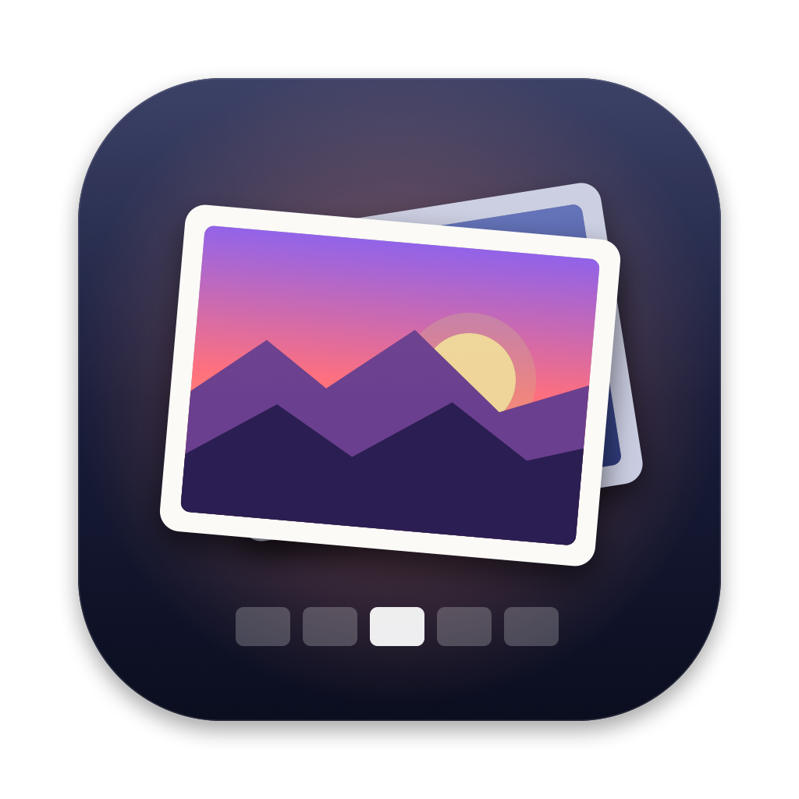

<div align="center">



# Picasso for Mac

**A fast, free, open-source fullscreen photo viewer for macOS: a Picasa Photo Viewer alternative for Mac.**
Double-click a photo and it opens over your desktop on a dimmed backdrop. No library, no import, no window chrome.
Arrow keys go through the whole folder, and a click anywhere outside the photo closes it.


**[⬇ Download the latest release](https://github.com/penguinpecker/picasso-for-mac/releases/latest)**

</div>

---

If you miss the old **Picasa Photo Viewer** (photos opening over a dimmed desktop, big arrows, a filmstrip at the bottom, click-outside-to-close), this is that experience, rebuilt natively for the Mac. Picasso is a lightweight **image viewer for Mac**. It takes over the screen your cursor is on and lets the desktop show through a translucent dark (or blurred) backdrop, then fits your photo in the middle. It opens instantly, keeps up when you hold an arrow key through a folder of thousands of photos, and **never writes to your files**. Viewing only: no editing, no catalog, no account.

It's a native Swift + AppKit app with **zero third-party dependencies**: Apple's ImageIO for decoding, Core Animation for drawing. It builds as a universal binary for Apple Silicon and Intel Macs on macOS Sonoma 14 or later.

## Features

- **Fullscreen overlay viewer**: a borderless window that covers the whole screen, including the menu bar and Dock, on a semi-transparent backdrop (dim or blur, adjustable opacity). It opens over other apps' fullscreen Spaces too.
- **Instant open and close**: a short zoom-and-fade on open and a fade on close. Click the backdrop or press <kbd>Esc</kbd> to close.
- **Whole-folder browsing**: opening one photo lists every supported image in its folder, sorted the way Finder sorts names (`img2` before `img10`).
- **Big hover arrows** on the left and right edges, plus a **floating control bar** with previous/next, rotate left/right, a zoom slider, fit / actual size and a **slideshow**.
- **Thumbnail strip** that keeps the current photo centered. Click any thumbnail to jump to it. It stays smooth with 1,000+ images.
- **Filename and position** overlay (`IMG_0042.HEIC  12 / 87`).
- **Auto-hiding controls**: everything, the cursor included, fades out after 3 seconds without mouse movement.
- **Zoom that follows your pointer**: pinch, <kbd>⌘</kbd>+scroll or double-click zooms at the cursor, and you can drag to pan. Small images are never stretched past 100%.
- **Fast**: decoding happens off the main thread, the 2 images before and after the current one are preloaded, there's a memory-capped decode cache, very large photos are downsampled to screen size (full resolution loads only when you zoom in), and thumbnails come from embedded previews.
- **Animated GIF playback**, with **EXIF orientation** respected for every format.
- **Read-only by design**: it never creates, edits, renames, moves, tags or deletes a file. Rotation is view-only and isn't saved.

## Supported formats

JPEG · PNG · HEIC / HEIF · WebP · GIF (animated) · TIFF · BMP · **RAW** (CR2, CR3, NEF, ARW, DNG, RAF, ORF and every other camera format macOS's ImageIO can decode) · plus anything else ImageIO reads (AVIF, JPEG 2000, PSD, …).

## Keyboard, mouse and trackpad

| Action | Keyboard | Mouse | Trackpad |
|---|---|---|---|
| Next / previous photo | <kbd>→</kbd> / <kbd>←</kbd>, <kbd>Space</kbd> = next | Scroll wheel | Two-finger swipe left / right |
| First / last photo | <kbd>Home</kbd> / <kbd>End</kbd> (<kbd>Fn</kbd>+<kbd>←</kbd> / <kbd>→</kbd>) | | |
| Zoom in / out | <kbd>+</kbd> / <kbd>−</kbd> | <kbd>⌘</kbd> + scroll (at cursor) | Pinch (at fingers) |
| Fit to screen / actual size | <kbd>0</kbd> / <kbd>1</kbd> | Double-click the photo | |
| Pan a zoomed photo | | Drag | Two-finger scroll |
| Rotate right / left (view only) | <kbd>R</kbd> / <kbd>⇧</kbd>+<kbd>R</kbd> | Bar buttons | |
| Settings | <kbd>⌘</kbd>+<kbd>,</kbd> | | |
| Close (quits the app) | <kbd>Esc</kbd>, <kbd>⌘</kbd>+<kbd>W</kbd>, <kbd>⌘</kbd>+<kbd>Q</kbd> | Click outside the photo | |

Hold <kbd>→</kbd> to go through a folder: the viewer shows a preview for every step and loads full quality where you stop.

## Install

### Download (easiest)

1. Download **Picasso.zip** from the [latest release](https://github.com/penguinpecker/picasso-for-mac/releases/latest) and unzip it.
2. Drag **Picasso.app** into **Applications**.
3. The app is open source and isn't notarized by Apple, so the first time you open it macOS asks you to confirm. Open it once, then go to **System Settings → Privacy & Security** and click **Open Anyway**. Or run this in Terminal:
   ```bash
   xattr -dr com.apple.quarantine /Applications/Picasso.app
   ```

### Build from source

You need macOS 14 Sonoma or later and Apple's Command Line Tools (`xcode-select --install`). Full Xcode is optional.

```bash
git clone https://github.com/penguinpecker/picasso-for-mac.git
cd picasso-for-mac
Scripts/build.sh                      # → build/Picasso.app (universal: Apple Silicon + Intel)
cp -R build/Picasso.app /Applications/
```

Prefer Xcode? Open `Picasso.xcodeproj` and press <kbd>⌘</kbd>+<kbd>R</kbd>.

Picasso runs without a Dock icon, the way an overlay viewer should. Open photos from Finder. Launching the app on its own shows a file picker where you can choose a photo or a whole folder.

## Make Picasso your default photo viewer

Do this once for each file type you want it to open (for example `.jpg`, `.png` and `.heic`):

1. In Finder, select a photo of that type and press <kbd>⌘</kbd>+<kbd>I</kbd> (**Get Info**).
2. Under **Open with**, choose **Picasso**. If it isn't listed, choose **Other…** and pick it in Applications.
3. Click **Change All…**, then **Continue**.

From then on, double-clicking any file of that type opens it in Picasso. For a one-off, right-click a photo and choose **Open With → Picasso**.

## Settings

Press <kbd>⌘</kbd>+<kbd>,</kbd> while viewing. Changes apply immediately.

- **Backdrop opacity**: 30–100% (default 75%)
- **Backdrop style**: Dim or Blur (frosted glass)
- **Scroll wheel**: next/previous photo, or zoom
- **Show thumbnail strip**: on or off

## FAQ

**Is Picasso free?** Yes. It's free and open source with no ads, accounts or tracking. It makes no network requests at all.

**Does it change or move my photos?** Never. Files are opened read-only through ImageIO. Rotating is a view-only effect, and the app writes nothing except its own settings.

**Does it work on Intel Macs and Apple Silicon (M1, M2, M3, M4)?** Yes. The build script produces a universal binary.

**Can it open a whole folder?** Yes. Open any photo and the rest of its folder is one arrow key away, or launch the app and choose a folder.

**Why doesn't it have a Dock icon?** It's an overlay viewer: it appears when you open a photo and quits when you close it.

**How is this different from Preview or Quick Look?** Preview opens photos in a window, and Quick Look doesn't let you keep browsing a folder. Picasso is a fullscreen, keyboard-first way to flip through a folder of photos over your desktop, and close it with one click.

## Development

```bash
Scripts/build.sh            # release, universal  → build/Picasso.app
Scripts/build.sh debug      # debug, universal
Scripts/test.sh             # GUI self-tests (takes over the screen for a minute)
```

`Scripts/test.sh` builds a separate test copy that runs scripted scenarios through the real event paths (keys, mouse, scroll, swipes). It checks window placement, fit and zoom math, folder order, navigation, controls, the thumbnail strip, fly-through timing and memory, and checks that no file was modified.

```
Picasso/
  main.swift, AppDelegate.swift   launch, Finder "Open With", open panel, menu
  ViewerWindow.swift              borderless key window
  ViewerController.swift          window, backdrop, navigation, keys/scroll, slideshow
  ImageCanvasView.swift           image layer, zoom / pan / rotate, clicks
  ControlsOverlay.swift           edge arrows, control bar, name pill, auto-hide
  ThumbnailStrip.swift            virtualized thumbnail strip
  ImageLoader.swift               ImageIO decoding, cache, preload, GIF frames
  FolderIndex.swift               folder listing in Finder order
  Settings.swift                  preferences + settings window
  SelfTest.swift                  test harness (compiled only into the test build)
```

## License

[MIT](LICENSE). Free to use, change and share.

## Uninstall

Drag `/Applications/Picasso.app` to the Trash. To also remove its settings, run `defaults delete com.penguinpecker.Picasso`.

---

<sub>Keywords: Picasa Photo Viewer for Mac, Picasa alternative for macOS, Picasa viewer replacement, fullscreen photo viewer for Mac, fast image viewer macOS, lightweight picture viewer, open-source image viewer for macOS Sonoma and Sequoia, HEIC viewer, WebP viewer for Mac, RAW photo viewer, slideshow app for Mac, Finder default image viewer.</sub>

<sub>Picasa is a trademark of Google LLC. Picasso for Mac is an independent project, not affiliated with or endorsed by Google.</sub>
